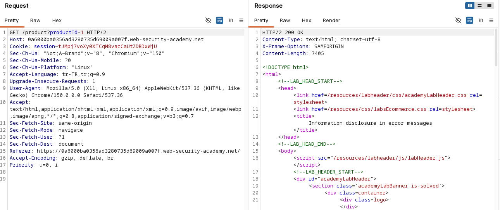

## Cheat Sheet 
Check out the related Information Disclosure Vulnerabilities Cheat Sheet:
**[Information Disclosure Vulnerabilities Cheat Sheet](/cheat-sheets/#information-disclosure)**

## Introduction

Information Disclosure is when an application accidentally shows sensitive or important information that it should not normally show to users.

For example:

- Error messages

```
SQL syntax error near'users' at /var/www/html/login.php:42
```

- `.git` folder exposure

```
https://site.com/.git/
```

- Backup files

```
/config.php
/config.php.bak
/config.php.old
```

This vulnerability is usually not a direct attack like RCE by itself, but it can help find other vulnerabilities.

For example:

```
Information Disclosure
        ↓
Server version
        ↓
Used framework
        ↓
Research known vulnerabilities
        ↓
Exploit another vulnerability
```

## Labs

### **01. Information disclosure in error messages**

A normal product request is sent with the `productId=1` parameter, and the application returns a successful response.



The error is triggered by sending an invalid value (moren) to the productId parameter.


After the error, the application returns a detailed stack trace, and Apache Struts 2.3.31 information is revealed in the response.

### **02. Information disclosure on debug page**

The /cgi-bin/phpinfo.php debug endpoint is discovered in the Burp Suite Site Map.


The request sent to the debug endpoint uses the correct Host value for the lab, and access to the endpoint is obtained.


The phpinfo.php response is checked, and the SECRET_KEY environment variable is exposed.

### **03. Source code disclosure via backup files**

The /backup directory is discovered by checking the robots.txt file.


When the /backup directory is accessed, a backup file named ProductTemplate.java.bak is found.


The backup file contains source code with PostgreSQL connection information and a hard-coded database password.


This part creates a connection to the PostgreSQL database:
```
ConnectionBuilder.from(
"org.postgresql.Driver",    → Driver
"postgresql",               → Database
"localhost",                → Host
5432,                       → Port
"postgres",                 → username
"postgres",
"iv8wbubvimymef4pym7v7i7tibugd9k6"  → Password
)
```

### **04. Authentication bypass via information disclosure**

After logging in as Wiener, the login request is sent to Repeater to start manual testing of the /login request.


The request in Repeater is changed to the /admin endpoint to try to access the admin panel. The application says that only local users can access it.


A TRACE /admin request is sent to discover the X-Custom-IP-Authorization header added to the request by the application.


The X-Custom-IP-Authorization value is changed to 127.0.0.1, making the request look like it comes from a local user.


The GET /admin request is sent with the 127.0.0.1 header, and access to the admin panel is obtained.


A request is then sent to delete the carlos user from the admin panel:
```bash
GET /admin/delete?username=carlos
```


### **05. Information disclosure in version control history**

The /.git directory is found to be accessible through the URL, and the files in the Git repository are listed.


The exposed .git directory is downloaded to the local machine using the wget -r command.
```bash
wget -r https://0abd006803bb2ec388b7a0ed00b00012.web-security-academy.net/.git/
```

The commit history and changes in the repository are viewed using the git log command.


The changes in the commits are examined in detail using git log -p, revealing the admin password that was removed in an older commit.

