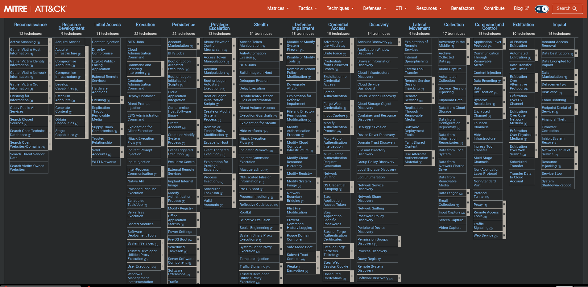

MITRE ATT&CK, siber saldırganların kullandığı yöntemleri, teknikleri ve davranışları sınıflandıran bir bilgi tabanıdır. Yani bir saldırgan sisteme nasıl sızar, içeride ne yapar ve hedefine nasıl ulaşır gibi soruları cevaplar.

MITRE ATT&CK yapısını incelemeye başladığımda ilk önce beni `matrix` kısmı karşılıyor.

**Matrix**, MITRE ATT&CK’ın genel haritasıdır. Taktik ve teknikleri bir arada gösterir.

MITRE ATT&CK'te **Enterprise, Mobile ve ICS**, saldırgan davranışlarının incelendiği üç farklı teknoloji alanıdır. Yani bunlar saldırı aşaması değil, saldırının hangi teknoloji ortamında gerçekleştiğini belirten kategorilerdir.

1. **Enterprise** → Kurumsal bilişim sistemlerine yönelik siber saldırıları kapsayan kategoridir.
    
    Kapsadığı platformlar:
    
    - Windows
    - Linux
    - macOS
    - Azure ve AWS
    - Network Devices
    - Containers
2. **Mobile** → Mobil cihazlara yönelik siber saldırıları kapsayan kategoridir. Android ve iOS işletim sistemlerini hedef alan saldırgan taktiklerini ve tekniklerini sınıflandırır.
3. **ICS** → Endüstriyel kontrol sistemlerine yönelik siber saldırıları kapsayan kategoridir. SCADA, PLC ve endüstriyel otomasyon sistemleri gibi kritik altyapıları hedef alan saldırgan taktiklerini ve tekniklerini sınıflandırır.

**Taktik,** saldırganın ulaşmak istediği amaçlardır. Taktikler saldırı sürecinin aşamalarını anlamamızı sağlar. Ancak her saldırı bunları mutlaka aynı sırayla izlemez. Bir saldırgan bazı aşamaları atlayabilir veya tekrar edebilir.

**Teknik** ise, saldırganın belirli bir taktik kapsamında amacına ulaşmak için kullandığı saldırı yöntemidir. Bir taktik altında birden fazla teknik bulunabilir.

### Taktik Aşamaları:

1. **Reconnaissance (***TA0043***)**  
    
    İlk taktik saldırganın gelecekteki saldırılarını planlamak için hedef hakkında bilgi toplamasıdır. Yani saldırganın hemen sisteme erişmeye çalışmayıp hedefi tanımaya çalışmasıdır. 
    
    **Saldırgan hangi bilgileri toplayabilir?**
    
    | Toplanabilecek bilgi | İlişkili MITRE tekniği |
    | --- | --- |
    | Kurumun adı ve organizasyon yapısı | Gather Victim Org Information |
    | Çalışanların isimleri ve e-posta adresleri | Gather Victim Identity Information |
    | Alan adları ve IP adresleri | Search Open Websites/Domains |
    | Kullanılan teknolojiler ve sunucular | Gather Victim Host Information |
    | Ağ altyapısı ve açık servisler | Gather Victim Network Information / Active Scanning |
    | Çalışanlardan bilgi elde etme | Phishing for Information |
    | İnternete açık sistemler ve web siteleri | Search Victim-Owned Websites |
    | Teknik bilgiler ve açık veri tabanları | Search Open Technical Databases |
    | Kapalı kaynaklardan bilgi toplama | Search Closed Sources |
    | Tehdit istihbaratı sağlayıcılarından bilgi toplama | Search Threat Vendor Data |
    
2. **Resource Development (***TA0042***)**
    
    Bu taktik ise kaynak araştırması aşamasıdır. Saldırgan gelecekte gerçekleştireceği saldırıları desteklemek için gerekli kaynakları oluşturması veya satın almasıdır.
    
    Yine bu aşamada saldırı yoktur, saldırgan saldırıda kullanacağı araçları ve altyapıyı hazırlar.
    
    **Saldırgan bu aşamada ne hazırlayabilir?** 
    
    Mitre Attackta bu taktik altında 9 ana teknik bulunuyor:
    
    - Acquire Infrastructure: Altyapı edinme
    - Compromise Accounts: Hesapları ele geçirme
    - Develop Capabilities: Saldırı araçları geliştirme
    - Establish Accounts: Hesap oluşturma
    - Obtain Capabilities: Araç veya zararlı yazılım edinme
    - Stage Capabilities: Saldırı araçlarını kullanıma hazır hâle getirme

1. **Initial Access (***TA0001***)**
    
    Bu taktik ilk erişim aşamasıdır. Saldırganın hedef sistem veya ağa ilk kez erişim sağlamak için kullandığı yöntemleri kapsayan taktiktir.
    
    **Saldırganın ilk erişim için yapabilecekleri:**
    
    - Kimlik avı (Phishing) saldırısı gerçekleştirebilir
    - Güvenlik açıklarından yararlanabilir
    - Çalınmış hesap bilgilerini kullanabilir
    - Zararlı dosyalar aracılığıyla sisteme erişebilir
    - Harici erişim noktalarını hedef alabilir
    
    **Saldırganın kullanabileceği teknik ve giriş yolları ne olabilir?**
    
    | Teknik | Saldırganın kullandığı giriş yolu |
    | --- | --- |
    | Phishing | Kullanıcıyı kandırma |
    | Drive-by Compromise | Web sitesi ziyareti |
    | Exploit Public-Facing Application | Uygulama açığı |
    | External Remote Services | VPN / RDP gibi servisler |
    | Valid Accounts | Gerçek kullanıcı hesapları |
    | Wi-Fi Networks | Kablosuz ağ |
    | Supply Chain Compromise | Tedarik zinciri |
2. **Execution (*TA0002*)**
    
    Bu taktik execution yani çalıştırma, saldırganın hedef üzerinde zararlı kod veya komut çalıştırmasıdır.
    
    **Saldırgan neler yapabilir?**
    
    - PowerShell veya CMD üzerinden komut çalıştırabilir
    - Zararlı dosyaları çalıştırabilir
    - Script dosyalarını kullanabilir
    - Windows servislerini kötüye kullanabilir
    - Linux Shell üzerinden komut çalıştırabilir
    - WMI aracılığıyla komut çalıştırabilir
    
    MITRE'nin güncel sayfasında 22 ana teknik bulunuyor. Öne çıkan bazı teknikler:
    
    | Teknik | Açıklama |
    | --- | --- |
    | Command and Scripting Interpreter (T1059) | Komut ve script yorumlayıcılarını kullanma |
    | User Execution (T1204) | Kullanıcının işlem yapmasını sağlayarak kod çalıştırma |
    | Windows Management Instrumentation (T1047) | WMI üzerinden komut çalıştırma |
    | Scheduled Task/Job (T1053) | Zamanlanmış görevleri kullanma |
    | System Services (T1569) | Sistem servisleri üzerinden kod çalıştırma |
    | Shared Modules (T1129) | Paylaşılan modüller aracılığıyla kod çalıştırma |
    | Native API (T1106) | İşletim sisteminin yerel API'lerini kullanma |

1. **Persistence (***TA0003***)**
    
    Bu taktik olan kalıcılık ise, saldırganın hedef sistemde kalıcılık sağlayacak hamle yapmasıdır. Yani saldırganın ele geçirdiği sistem veya ağ üzerindeki erişimini, sistem yeniden başlatılsa veya kullanıcı parolaları değiştirilse bile devam ettirmeye çalıştığı taktiktir.
    
    **Saldırgan hedef sistemde kalıcılık sağlamak için neler yapabilir?**
    
    - Sisteme yeni kullanıcı hesabı ekleyebilir
    - Windows Registry üzerinden başlangıç ayarlarını değiştirebilir
    - Açılışta otomatik çalışan zararlı dosyalar yerleştirebilir
    - Zamanlanmış görevler oluşturabilir
    - Windows servislerini değiştirebilir
    - SSH anahtarları ekleyebilir
    - Web sunucusuna Web Shell yerleştirebilir
    
    MITRE Enterprise Matrix'te bu taktik altında 22 ana teknik bulunuyor. Bazı öne çıkan teknikler:
    
    - Account Manipulation (T1098)
    - Boot or Logon Autostart Execution (T1547)
    - Create Account (T1136)
    - Scheduled Task/Job (T1053)
    - Create or Modify System Process (T1543)
    - Valid Accounts (T1078)
    - Web Shell (T1505.003)
    
2. **Privilege Escalation (***TA0004***)**
    
    Buradaki taktikte, hedef sistemde erişimi elde ettikten saldırganın sistemde sahip olduğu yetkilerden daha yüksek yetkiler elde etmesidir.
    
    Örneğin:
    
    - Standart kullanıcıdan Administrator yetkisine geçmek
    - Linux'ta normal kullanıcıdan root yetkisine yükselmek
    - Active Directory ortamında Domain Admin yetkisi elde etmek

1. **Defense Evasion - Stealth (***TA0005***)**
    
    Buradaki taktik ise saldırganın hedef sistemde gerçekleştirdiği faaliyetlerin güvenlik mekanizmaları tarafından tespit edilmesini zorlaştırmaya veya engellemeye çalıştığı taktiktir.
    
    **Saldırgan tespit edilmekten kaçınmak için neler yapabilir?**
    
    - Güvenlik yazılımlarından kaçınmaya çalışabilir
    - Zararlı dosyaları gizleyebilir
    - Dosya ve komutları şifreleyebilir veya gizleyebilir
    - Sistem günlüklerini (logs) silebilir
    - Zararlı yazılımları meşru programlar gibi gösterebilir
    - İşletim sisteminin güvenilir araçlarını kötüye kullanabilir
    - Rootkit kullanarak faaliyetlerini gizleyebilir
    
2. **Defense Impairment (***TA0112***)**
    
    Bu taktiğin amacı, hedef sistemin güvenlik mekanizmalarını bozmak, devre dışı bırakmak veya çalışmalarını engellemektir. Saldırgan yalnızca sistemde gizlenmeye çalışmaz; savunma sistemlerinin saldırıyı tespit etmesini veya kaydetmesini de zorlaştırır.
    
    Saldırgan:
    
    1. Güvenlik aracının/duvarının çalışmasını engellemeye çalışabilir
    2. Güvenlik günlüklerinin toplanmasını aksatabilir
    3. Güvenlik izleme mekanizmalarını etkisiz hâle getirmeye çalışabilir
    
    Böylece savunma ekibinin saldırıyı fark etmesi zorlaşabilir
    

1. **Credential Access** (*TA0006*)
    
    Bu taktikte saldırganın kullanıcı adı, parola, parola özeti (hash), erişim token'ı veya Kerberos bileti gibi kimlik doğrulama bilgilerini ele geçirmesidir. Saldırganın amacı bu bilgileri kullanarak başka hesaplara, sistemlere veya servislere erişebilmektir.
    
    Örneğin saldırgan,
    
    - Parolaları tekrar tekrar deneyerek bulmaya çalışabilir
    - Klavye girişlerini veya kullanıcı girdilerini yakalayabilir
    - Oturum çerezlerini ele geçirebilir
    - İki cihaz arasındaki iletişime girerek kimlik bilgilerini yakalayabilir

1. **Discovery (***TA0007***)**
    
    Buradaki taktikte ise bu sefer erişim kazanılmış olan hedef sistemde bilgi toplama taktiği. Reconnaissance’dan farkı erişim sağladıktan sonra sistemin ve ağın içini tanımak.
    
    **Saldırgan hedefe eriştikten sonra nelere bakabilir?**
    
    - Sistemde hangi kullanıcılar var?
    - Hangi bilgisayarlar ve sunucular bulunuyor?
    - Hangi servisler ve uygulamalar çalışıyor?
    - Ağda hangi cihazlar var?
    - Hangi dosyalara ve kaynaklara erişilebilir?
    - Sistem hangi güvenlik ayarlarını kullanıyor?
    
2. **Lateral Movement (***TA0008***)**
    
    On birinci taktikte, saldırganın ele geçirdiği bir sistemden aynı ağdaki başka sistemlere geçiş yapma taktiğidir. Saldırgan ilk bilgisayara eriştikten sonra orada kalmak yerine ağdaki diğer bilgisayarlara, sunuculara veya Domain Controller'a ulaşmaya çalışır.
    
    **Saldırgan neler yapabilir?**
    
    - RDP ile başka bilgisayarlara bağlanabilir
    - SMB üzerinden paylaşılan dosyalara erişebilir
    - SSH ile uzak sunuculara geçebilir
    - Uzak servislerdeki güvenlik açıklarından yararlanabilir
    - Zararlı araçları diğer sistemlere taşıyabilir
    
3. **Collection (***TA0009***)**
    
    Bu taktikte ise amaç, saldırganın ele geçirdiği sistemlerde veya ağda verileri toplamasıdır. Saldırgan bu aşamada bilgileri hemen dışarı çıkarmak zorunda değildir. Önce işine yarayacak verileri bulur ve bir araya getirir.
    
    **Saldırgan neler yapabilir?**
    
    - Bilgisayardaki önemli dosyaları ve belgeleri toplayabilir.
    - E-postaları ve mesajları inceleyebilir.
    - Tarayıcı oturumlarından veri elde edebilir.
    - Kopyalanan metinleri panodan alabilir.
    - Ekran görüntüsü veya video kaydı alabilir.
    - Mikrofon ve kamera üzerinden kayıt yapabilir.

1. **Command and Control (***TA0011***)**
    
    Bu taktikte, saldırganın ele geçirdiği sistemlerle uzaktan iletişim kurarak onları kontrol etmesi. Saldırgan, ele geçirdiği bilgisayara komut göndermek ve bilgisayardan sonuç almak için bir iletişim kanalı oluşturur. Bu iletişimi normal ağ trafiği gibi göstermeye de çalışabilir.
    
    **Peki saldırgan neler yapabilir?**
    
    - HTTP/HTTPS kullanarak internet sitelerine yapılan bağlantılara benzer bir iletişim kurabilir
    - DNS kullanarak DNS sorgularını iletişim için kullanabilir
    - Şifreleme kullanarak saldırgan ile bilgisayar arasındaki mesajları başkalarının okumasını zorlaştırabilir
    - Proxy kullanarak bağlantısını başka sunucular üzerinden geçirebilir
    
2. **Exfiltration (***TA0010***)**
    
    Bu taktikte de saldırganın amacı ele geçirdiği ve topladığı verileri hedef sistemin veya kurumun dışına çıkarmasıdır. Hem fiziksel hem de dijital yöntemlerle veri dışarı çıkarılmasını kapsar.
    
    **Saldırgan neler yapabilir?**
    
    - Topladığı verileri kurum dışındaki sunuculara gönderebilir
    - USB bellek veya harici disk kullanabilir
    - Verileri e-posta veya web servisleri üzerinden dışarı çıkarabilir
    - Verileri sıkıştırıp arşivleyebilir
    - Verileri şifreleyerek aktarabilir
    - Veri aktarımını otomatikleştirebilir
    - Aktarımı belirli saatlere planlayabilir

1. **Impact (***TA0040***)**
    
    Son olarak bu taktikte de amaç saldırganın hedef sistemlere veya verilere zarar vermesi, sistemlerin çalışmasını engellemesi ya da verileri değiştirmesidir.
    
    Defense Impairment’te amaç savunma sistemlerine zarar vermek, Impact’te amaç hedef sistemlere ve verilere zarar vermektir.
    
    **Saldırgan neler yapabilir?**
    
    - Dosyaları silebilir veya yok edebilir
    - Dosyaları şifreleyerek erişilemez hâle getirebilir
    - Veritabanındaki bilgileri değiştirebilir
    - Web sitelerinin içeriklerini değiştirebilir
    - Kullanıcı hesaplarını kilitleyebilir veya silebilir
    - Sunucu ve sistemleri kapatabilir
    - Kritik servisleri durdurabilir
    - Disklerdeki verileri silebilir

MITRE ATT&CK’daki bir diğer kısım ise defenses’dir.

**Defenses**, MITRE ATT&CK'te savunma odaklı içeriklerin tamamını kapsayan üst başlıktır. Altında 3 bölüm bulunur. Bunlar:

- **Mitigations →** Saldırganların kullandığı tekniklerin başarılı olmasını önlemek veya saldırının etkisini azaltmak için uygulanan güvenlik önlemleridir.

- **Assets →** Savunma amacıyla kullanılan güvenlik ürünlerini, teknolojilerini ve sistemlerini ifade eder. Savunma faaliyetlerinde hangi araç ve teknolojilerden yararlanıldığını gösterir.

- **Detections →** Saldırganların gerçekleştirdiği teknikleri ve şüpheli aktiviteleri belirlemek için kullanılan tespit yöntemlerini ifade eder. Hangi aktivitelerin izleneceğini ve hangi verilerin analiz edileceğini açıklar. Tespitlerde kendi içinde bölümlere ayrılır:
    - Detection Strategies: Tespit yaklaşımı.
    - Analytics: Tespit mantığı ve kuralları.
    - Data Components: Tespit için gereken veriler.
    
    

**CTI (Cyber Threat Intelligence)**, siber tehdit istihbaratı anlamına gelir. MITRE ATT&CK'in bu bölümü, gerçek dünyada faaliyet gösteren saldırgan grupları, kullandıkları araçları ve gerçekleştirdikleri saldırı kampanyalarını incelemeni sağlar.

CTI altında üç bölüm var:

- **Groups (Saldırgan Gruplar)**
    
    Siber saldırılar gerçekleştirdiği bilinen tehdit aktörlerini ve gruplarını tanımlar. Grupların hedeflerini, faaliyetlerini ve kullandıkları saldırı tekniklerini gösterir.
    
    **Örnek:** APT28, Lazarus Group, APT29.
    
- **Software (Yazılımlar)**
    
    Saldırganların operasyonlarında kullandıkları zararlı yazılımları, araçları ve sistem araçlarını içerir.
    
    **Örnek:** Cobalt Strike, Mimikatz, Emotet. Hangi saldırı teknikleriyle ilişkili olduklarını da görebilirsin.
    
- **Campaigns (Saldırı Kampanyaları)**
    
    Belirli bir zaman aralığında, ortak hedefler ve amaçlar doğrultusunda gerçekleştirilen saldırı faaliyetlerini tanımlar.
    
    **Örnek:** 2015 Ukrayna Elektrik Şebekesi saldırısı. Bu kampanyada Sandworm grubu BlackEnergy ve KillDisk gibi yazılımlar kullandı.

## Sonuç

MITRE ATT&CK, siber saldırganların kullandığı yöntemleri anlamak ve bu yöntemlere karşı savunma stratejileri geliştirmek için önemli bir bilgi kaynağıdır. Taktik ve teknikler sayesinde saldırgan davranışlarını inceleyebilir, Mitigations ile saldırıları önlemeye yönelik önlemleri öğrenebilir, Detections ile şüpheli aktivitelerin nasıl tespit edilebileceğini anlayabiliriz.

Ancak MITRE ATT&CK'i öğrenmek yalnızca teknikleri ve tanımları incelemekten ibaret değildir. Önemli olan, bu bilgileri gerçek sistemler üzerinde uygulayabilmek, saldırı davranışlarını analiz edebilmek ve savunma mekanizmalarını geliştirebilmektir.

Bu nedenle MITRE ATT&CK'i bir ezber kaynağı olarak değil, siber güvenlik alanında saldırı ve savunma süreçlerini anlamaya yardımcı olan bir rehber olarak değerlendirmek gerekir.