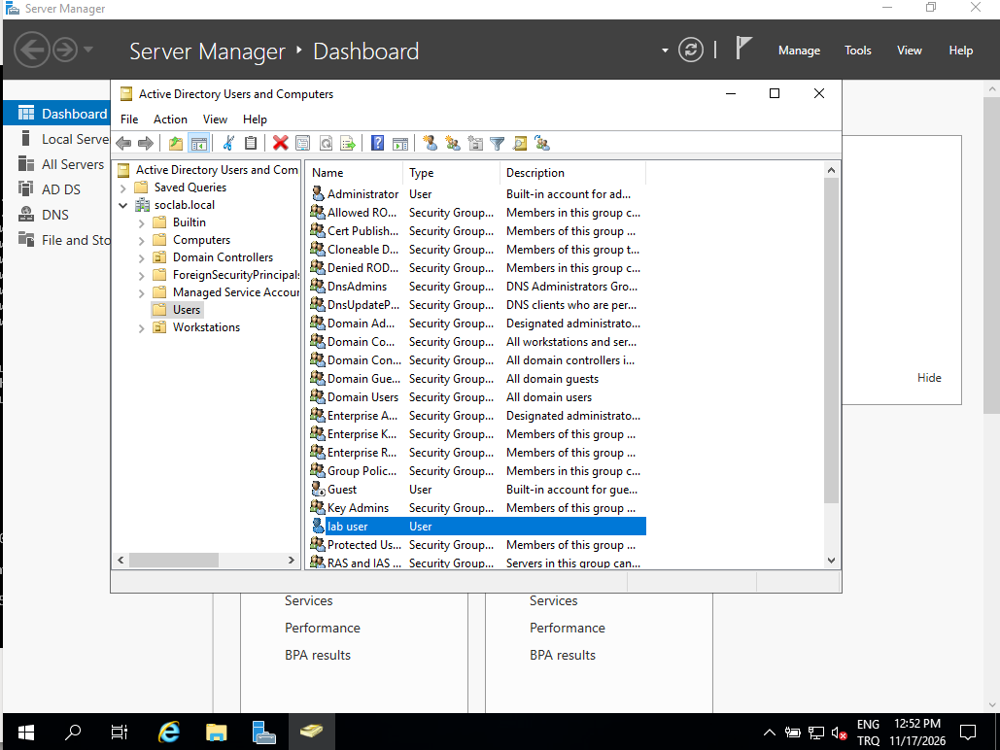

*TA0001 - Initial Access*

**Valid Accounts,** saldırganın ele geçirdiği veya kötüye kullandığı geçerli kullanıcı hesaplarıyla bir sisteme ya da ağa erişmesidir.

Yani saldırgan her zaman bir açığı kullanmak zorunda değildir, bazen sadece doğru kullanıcı adı ve şifreye sahip olması yeterlidir.

Örneğin, bir şirketin Active Directory ortamında saldırganın Ahmet isimli kullanıcının parolasını ele geçirdiğini düşünelim. Saldırgan bu bilgilerle VPN veya RDP üzerinden sisteme erişebilir. Kimlik bilgileri geçerli olduğu için sistem, bu erişimi normal bir kullanıcı oturumu gibi değerlendirebilir.

Saldırgan, normal bir kullanıcı gibi görünür.

### **Alt Teknikleri**

T1078'in dört alt tekniği bulunur:

| ID | Alt teknik | Açıklama |
| --- | --- | --- |
| T1078.001 | Default Accounts | Varsayılan hesapların kötüye kullanılması |
| T1078.002 | Domain Accounts | Domain hesaplarının kötüye kullanılması |
| T1078.003 | Local Accounts | Yerel kullanıcı hesaplarının kötüye kullanılması |
| T1078.004 | Cloud Accounts | Bulut hesaplarının kötüye kullanılması |

### **Tespit Yöntemleri**

Saldırgan geçerli bir hesap kullandığı için tespit etmek biraz zordur ama bazı belirtilerle fark edilebilir. Örneğin:

- Normalden farklı bir IP adresinden giriş yapılmışsa,
- Alışılmadık saatlerde oturum açılmışsa,
- Kullanıcı normalde erişemediği sistemlere bağlanmışsa,
- Bir hesabın farklı bilgisayarlarda kullanılması,
- Yetkili hesaplarda beklenmeyen aktivitelerin gerçekleşmesi.

### Laboratuvar Ortamı

Bu senaryoda kullandığım Active Directory ve Wazuh laboratuvar ortamının kurulumunu henüz gerçekleştirmediysen, öncelikle [**SOC Lab: MITRE ATT&CK Tabanlı Saldırı Tespit ve Müdahale Laboratuvarı**](/projects/soc-lab/) başlıklı yazıma göz atabilirsin.

Bu laboratuvar ortamında Windows Server 2019 üzerinde Active Directory Domain Services (AD DS) yapılandırılmış, Windows 10 istemcisi domain ortamına dahil edilmiş ve Wazuh SIEM kullanılarak sistemlerden alınan güvenlik kayıtlarının merkezi olarak izlenmesi sağlanmıştır.

### **Windows Event Log analizi**

Bu çalışmada, kurmuş olduğum Active Directory lab ortamında `SOCLAB.LOCAL` domain'ine bağlı `WIN10-CLIENT` bilgisayarını kullandım.

Active Directory üzerinde daha önceden oluşturduğum `lab.user` domain hesabıyla WIN10-CLIENT üzerinden oturum açtım. Ardından bu oturum açma işleminin Windows Event Log kayıtlarına nasıl yansıdığını ve Wazuh tarafından nasıl toplandığını inceledim.

İnceleme sırasında aşağıdaki Windows Event ID değerlerini kullandım:

| Event ID | Açıklama |
| --- | --- |
| 4624 | Başarılı oturum açma |
| 4625 | Başarısız oturum açma |
| 4648 | Açıkça belirtilen kimlik bilgileri |
| 4672 | Özel ayrıcalıklarla oturum açma |

#### 1. Başarılı Oturum Açma – Event ID 4624

İlk olarak başarılı oturum açma olaylarını görüntülemek için Wazuh Threat Hunting ekranında `data.win.system.eventID:4624` sorgusu kullandım.

Sorgu sonucunda toplam 67 başarılı oturum açma olayı görüntülendi. Ancak bu kayıtların tamamı test sırasında kullandığım `lab.user` hesabına ait değildi.

Bu nedenle incelemeyi belirli bir kullanıcıyla sınırlandırmak için `data.win.system.eventID:4624 AND data.win.eventdata.targetUserName:"lab.user"` sorgusunu kullandım.

Filtreleme sonucunda iki kayıt elde ettim:

| Agent | Rule ID | Açıklama |
| --- | --- | --- |
| DC01 | 60106 | Windows Logon Success |
| WIN10-CLIENT | 60118 | Windows Workstation Logon Success |

Bu sonuçlar, `lab.user` hesabıyla gerçekleştirilen test sırasında Wazuh'un hem DC01 hem de WIN10-CLIENT üzerinden başarılı oturum açma kayıtları topladığını gösteriyor.

**Oturum Açma Türünün İncelenmesi**

Elde ettiğim kayıtların ayrıntılarını inceleyerek `LogonType` alanını kontrol ettim. Bu alan, oturumun hangi yöntemle gerçekleştirildiğini anlamamı sağlıyor.

- `2`: Bilgisayar başında oturum açma
- `3`: Ağ üzerinden erişim
- `10`: Uzak Masaüstü (RDP) bağlantısı

Bu sayede başarılı oturum açma kayıtlarının yalnızca hangi bilgisayarda oluştuğunu değil, bağlantının nasıl gerçekleştirildiğini de inceleyebiliyorum.

- **DC01:** `LogonType 3` değeri, ağ üzerinden oturum açıldığını gösteriyor.
    
    

- **WIN10-CLIENT:** `LogonType 2` değeri, yerel/etkileşimli oturum açıldığını gösteriyor.
    
    
    
    WIN10-CLIENT kaydında IP adresi `127.0.0.1` olarak görünüyor. Bu adres, bilgisayarın kendisini işaret eden loopback (geri döngü) adresidir.

#### 2. Başarısız Oturum Açma – Event ID 4625

Başarısız oturum açma girişimlerini incelemek için `data.win.system.eventID:4625` sorgusunu kullandım.

Bu olaylar, yanlış parola kullanımı veya geçersiz kullanıcı bilgileriyle gerçekleştirilen oturum açma girişimlerini incelemek için kullanılabilir.

#### **3. Açıkça Belirtilen Kimlik Bilgileri – Event ID 4648**

Bir işlem veya kullanıcı tarafından açıkça belirtilen kimlik bilgilerinin kullanıldığı olayları görüntülemek için `data.win.system.eventID:4648` sorgusu kullanılır.

Bu kayıtlar, normal oturum açma sürecinden farklı olarak kimlik bilgilerinin açıkça sağlandığı durumları araştırmak için kullanılabilir.

**4. Özel Ayrıcalıklarla Oturum Açma – Event ID 4672**

Özel sistem ayrıcalıklarıyla ilişkilendirilen oturum açma olaylarını incelemek için `data.win.system.eventID:4672` sorgusunu kullandım.

Bu olay, oturum açan hesaba özel ayrıcalıklar atandığını gösterir. Özellikle yönetici yetkilerine sahip hesapların faaliyetlerini incelerken önemlidir.

### **Senaryonun MITRE ATT&CK ile İlişkilendirilmesi**

Bu çalışmada kendi Active Directory lab ortamımda oluşturduğum `lab.user` domain hesabıyla `WIN10-CLIENT` bilgisayarında oturum açtım ve Wazuh üzerinden oluşan Windows Event Log kayıtlarını inceledim.

Bu senaryoyu MITRE ATT&CK **T1078.002 – Domain Accounts** alt tekniğiyle ilişkilendirdim. Böylece geçerli bir domain hesabının kötüye kullanılması durumunda oluşabilecek oturum açma davranışlarını ve bu davranışların Wazuh üzerinden nasıl izlenebileceğini uygulamalı olarak incelemiş oldum.

Testi kendi lab ortamımda, kontrollü ve meşru bir oturum açma işlemiyle gerçekleştirdim.
