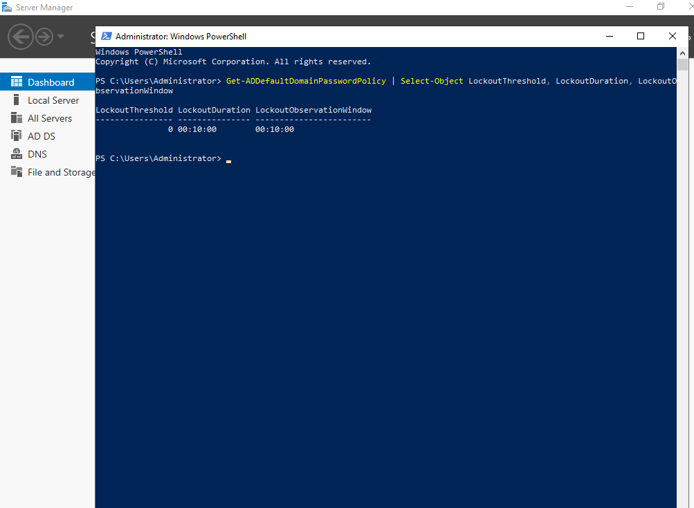

*TA0006 - Credential Access*

**Brute Force**, saldırganın bir hesaba erişmek ve kimlik bilgilerine erişmek amacıyla farklı parola tahminlerini sistematik ve tekrarlı şekilde denemesidir.

### Alt Teknikleri

MITRE ATT&CK sayfasında T1110'un dört alt tekniği bulunuyor:

| ID | Alt teknik | Açıklama |
| --- | --- | --- |
| T1110.001 | Password Guessing | Parola tahmin etme |
| T1110.002 | Password Cracking | Parola hash'lerini kırma |
| T1110.003 | Password Spraying | Birkaç yaygın parolayı çok sayıda hesapta deneme |
| T1110.004 | Credential Stuffing | Daha önce ele geçirilmiş kullanıcı adı ve parolaları tekrar kullanma |

### **Tespit Yöntemleri**

MITRE'nin belirttiği önemli tespit davranışları vardır:

- Kısa sürede çok fazla ve ardı ardına başarısız oturum açılmaya çalışıması ve parola denemesi yapılması,
- Çok fazla başarısız girişlerin ardından başarılı oturum açılması,
- Aynı IP adresinden birden fazla kullanıcı hesabına giriş denemesi yapılması

### Laboratuvar Ortamı

Bu senaryoda kullandığım Active Directory ve Wazuh laboratuvar ortamının kurulumunu henüz gerçekleştirmediysen, öncelikle [**SOC Lab: MITRE ATT&CK Tabanlı Saldırı Tespit ve Müdahale Laboratuvarı**](/projects/soc-lab/) başlıklı yazıma göz atabilirsin.

Bu laboratuvar ortamında Windows Server 2019 üzerinde Active Directory Domain Services (AD DS) yapılandırılmış, Windows 10 istemcisi domain ortamına dahil edilmiş ve Wazuh SIEM kullanılarak sistemlerden alınan güvenlik kayıtlarının merkezi olarak izlenmesi sağlanmıştır.


### **Windows Event Log analizi**

Brute Force simülasyonuna başlamadan önce, Active Directory ortamında bir hesabın kaç başarısız giriş denemesinden sonra kilitleneceğini öğrenmek istedim.

Bunun için Domain Controller üzerinde PowerShell'i açarak aşağıdaki komutu çalıştırdım:

```powershell
Get-ADDefaultDomainPasswordPolicy | Select-Object LockoutThreshold, LockoutDuration, LockoutObservationWindow
```

Komut ile üç önemli politika değerini inceledim:

- **LockoutThreshold:** Hesabın kilitlenmesine neden olacak başarısız giriş denemesi sayısı.
    
    `0` hesap kilitlemenin devre dışı olduğunu, `1` ise tek başarısız denemeden sonra kilitlemenin gerçekleşeceğini belirtir.
    
- **LockoutDuration:** Hesap kilitlendikten sonra kilidin ne kadar süreyle devam edeceği.
- **LockoutObservationWindow:** Başarısız giriş denemelerinin hangi zaman aralığında değerlendirileceği.



Bu değerleri kontrol etmemin amacı, gerçekleştireceğim Brute Force simülasyonunun Active Directory hesap kilitleme politikası üzerindeki etkisini önceden anlamaktı.

Simülasyonda hazır ve büyük bir wordlist kullanmak yerine, denemeleri kontrollü tutmak amacıyla kendime ait küçük bir parola listesi oluşturdum.

Fedora üzerinde aşağıdaki komutla `rdp-test.txt` isimli dosyayı oluşturdum:

```bash
printf '%s\n' 'TestWrong01!' 'TestWrong02!' 'TestWrong03!' > rdp-test.txt
```

Oluşturduğum dosyada üç farklı parola bulunuyordu. Bu parolalar, laboratuvar ortamındaki `lab.user` hesabına ait gerçek parola değildi. Amacım, başarısız kimlik doğrulama denemeleri oluşturarak Windows Event Log kayıtlarını incelemekti.

Parola listesini hazırladıktan sonra Fedora üzerinden Windows 10 istemcisine RDP protokolü aracılığıyla bağlantı denemeleri gerçekleştirdim.

Öncelikle hedef sistemin 3389 portunun erişilebilir olduğunu kontrol ettim. 

```python
nc -vz -w 3 192.168.56.103 3389
```


Ardından Hydra ile otomatik parola denemelerini başlattım:

```bash
hydra -l lab.user -P rdp-test.txt rdp://192.168.56.103
```

- `-l lab.user`: Denemelerin yapılacağı kullanıcı hesabı.
- `-P rdp-test.txt`: Kullanılacak parola listesinin bulunduğu dosya.
- `rdp://192.168.56.103`: Hedef sistem ve kullanılacak protokol.


Hydra üç parola denemesi gerçekleştirdi. Denemelerin tamamı başarısız oldu ve geçerli bir parola bulunamadı.

Bu aşamada amaç sisteme erişim sağlamak değil, başarısız kimlik doğrulama girişimlerinin Windows üzerinde nasıl loglandığını ve Wazuh tarafından nasıl toplandığını gözlemlemekti.

Hydra ile gerçekleştirdiğim denemelerin ardından Wazuh Dashboard'a geçerek Windows istemcisinden toplanan güvenlik kayıtlarını inceledim.

İlk olarak başarısız oturum açma girişimlerini görüntülemek için Threat Hunting bölümünde 
`data.win.system.eventID:4625` sorgusunu kullandım:


Windows'ta 4625 olayı, başarısız oturum açma girişimlerini ifade eder. Hydra ile gerçekleştirdiğim üç başarısız parola denemesinin ardından Wazuh üzerinde üç yeni 4625 kaydı görüntülendi.

Kayıtları daha ayrıntılı incelemek ve denemelerin Fedora üzerinden geldiğini doğrulamak için sorguyu kaynak IP adresine göre daralttım:
`data.win.system.eventID:4625 AND data.win.eventdata.ipAddress:"192.168.56.1"`


Bu sorgu sonucunda Fedora sisteminin IP adresinden gelen üç başarısız oturum açma kaydına ulaştım.

İncelediğim olay kayıtlarında öne çıkan alanlar şunlardı:


| Alan | Gözlemlenen değer | Açıklama |
| --- | --- | --- |
| Event ID | `4625` | Başarısız oturum açma |
| Target User Name | `lab.user` | Hedef kullanıcı hesabı |
| IP Address | `192.168.56.1` | Denemelerin geldiği Fedora IP adresi |
| Workstation Name | `fedora` | Kaynak bilgisayarın adı |
| Logon Type | `3` | Network logon |
| Authentication Package | `NTLM` | Kullanılan kimlik doğrulama paketi |
| Status | `0xc000006d` | Oturum açma başarısız |
| SubStatus | `0xc000006a` | Yanlış parola |

---

Özellikle `SubStatus` alanındaki `0xc000006a` değeri, kullanıcı adı doğru olsa da parolanın hatalı olduğunu gösteriyordu.

### **Brute Force Saldırılarına Karşı Alınabilecek Önlemler**

Gerçekleştirdiğim simülasyon, art arda yapılan başarısız parola denemelerinin Windows Event Log üzerinden izlenebildiğini gösterdi. Bu tür saldırıların etkisini azaltmak için aşağıdaki güvenlik önlemleri uygulanabilir.

**1. Hesap Kilitleme Politikası (Account Lockout Policy)**

Active Directory üzerinde belirli sayıda başarısız giriş denemesinden sonra hesabın geçici olarak kilitlenmesi sağlanabilir.

Örneğin:

- Başarısız deneme sınırı: 5
- Hesap kilitleme süresi: 15 dakika
- Deneme sayacının sıfırlanması: 15 dakika

Bu değerler örnek bir yapılandırmadır. Kurumun güvenlik ihtiyaçlarına göre belirlenmelidir.

**2. Çok Faktörlü Kimlik Doğrulama (MFA)**

Parolanın ele geçirilmesi durumunda bile ikinci bir doğrulama faktörü olmadan hesaba erişilmesini zorlaştırır.

**3. Güçlü Parola Politikası**

Tahmin edilmesi kolay ve tekrar kullanılan parolaların önüne geçmek için uzun, benzersiz parolalar kullanılmalıdır.

**4. Başarısız Giriş Denemelerinin İzlenmesi**

Windows Event ID `4625` kayıtları takip edilerek belirli bir zaman aralığında aynı kullanıcıya veya aynı IP adresine ait tekrarlanan başarısız girişimler tespit edilmelidir.

**5. Wazuh Üzerinde Alarm ve Korelasyon Kuralları**

Wazuh üzerinde belirli bir zaman aralığında art arda gerçekleşen başarısız girişimleri ilişkilendiren kurallar oluşturulabilir. Böylece yalnızca tekil başarısız girişimler değil, olası Brute Force davranışları da tespit edilerek güvenlik ekibine alarm üretilebilir.

**6. RDP Erişiminin Kısıtlanması**

RDP erişimi yalnızca gerekli kullanıcı ve sistemlere açılmalı; mümkünse VPN veya belirli IP adresleri üzerinden sınırlandırılmalıdır.