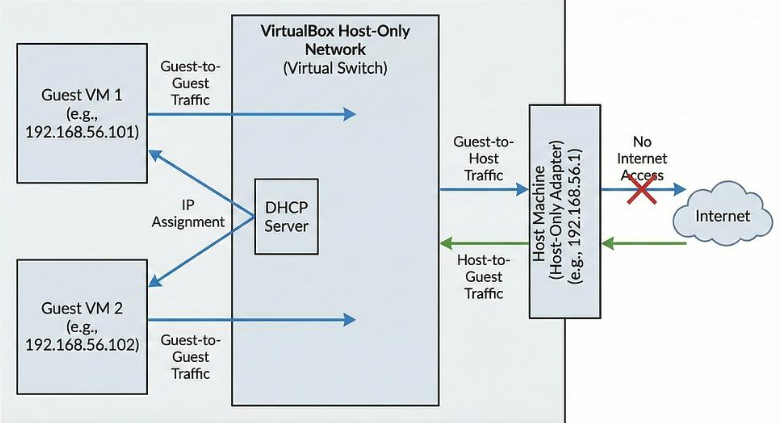

# Active Directory, Windows Server, Windows 10 ve Wazuh ile Uygulamalı SOC Laboratuvarı

*Active Directory, Windows Server, Windows 10 ve Wazuh ile Uygulamalı SOC Laboratuvarı Kurulumu*

## **1. Projenin Amacı**

Siber güvenlik alanında özellikle Blue Team, SOC (Security Operations Center), saldırı tespiti ve olay müdahalesi konularında uygulamalı deneyim kazanmak amacıyla izole bir sanal laboratuvar ortamı oluşturmaya başladım.

Bu projenin temel amacı, gerçek bir kurumsal ağ ortamını küçük ölçekte simüle ederek saldırıların nasıl gerçekleştirildiğini, bu saldırıların sistemlerde hangi izleri bıraktığını ve güvenlik araçları aracılığıyla nasıl tespit edilebileceğini incelemek.

Laboratuvar içerisinde aşağıdaki teknolojileri kullanmayı planlıyorum:

- **Windows Server 2019:** Active Directory ve Domain Controller.
- **Windows 10:** Domain'e bağlı istemci bilgisayar.
- **Wazuh:** Güvenlik olaylarının merkezi olarak izlenmesi ve analizi.
- **Sysmon:** Windows üzerinde ayrıntılı sistem olaylarının kaydedilmesi.
- **Suricata:** Ağ trafiğinin izlenmesi ve saldırı tespiti.
- **Shuffle SOAR:** Güvenlik olaylarına yönelik otomatik müdahale süreçleri.
- **MITRE ATT&CK:** Saldırı tekniklerinin sınıflandırılması ve senaryoların oluşturulması.

Projenin sonunda, bir saldırının başlangıcından tespit edilmesine ve müdahale edilmesine kadar uzanan uçtan uca bir güvenlik operasyonu gerçekleştirmeyi hedefliyorum.

## **2. Laboratuvar Mimarisi**

Laboratuvarı Fedora 44 işletim sistemi üzerinde Oracle VirtualBox kullanarak oluşturdum.

Sanal makinelerin birbirleriyle iletişim kurabilmesi ancak fiziksel ağdan izole kalabilmesi için VirtualBox'ın Host-only Adapter özelliğini tercih ettim.

Host-only ağ, sanal makinelerin kendi aralarında ve ana bilgisayarla iletişim kurmasını sağlar. Ancak tek başına internet erişimi sağlamaz.



### **Kullanılan sistemler**

| Sistem | İşletim sistemi | Görevi |
| --- | --- | --- |
| Host | Fedora 44 | Ana bilgisayar |
| DC01 | Windows Server 2019 | Domain Controller |
| WIN10-CLIENT | Windows 10 Pro | Domain istemcisi |
| Wazuh | Wazuh 4.14.9 OVA | Merkezi güvenlik izleme |

### **Ağ yapılandırması**

Laboratuvarda kullandığım Host-only ağın adı `vboxnet0`.

Şu ana kadar belirlediğimiz IP adresleri:

| Makine | IP adresi | Açıklama |
| --- | --- | --- |
| DC01 | `192.168.56.10` | Domain Controller |
| WIN10-CLIENT | `192.168.56.103` | Windows istemcisi |
| Wazuh | `192.168.56.104` | Wazuh sunucusu |

## **3. Windows Server 2019 Kurulumu**

İlk olarak Windows Server 2019 sanal makinesini oluşturdum.

Kurulum sırasında karşılaştığım ilk sorun, yanlışlıkla Server Core sürümünü seçmem oldu.

Server Core, grafiksel masaüstü arayüzü bulunmayan ve ağırlıklı olarak komut satırı üzerinden yönetilen bir Windows Server kurulum seçeneğidir.

Laboratuvarın ilk aşamasında grafiksel yönetim araçlarını kullanmak istediğim için kurulumu yeniden gerçekleştirerek **Windows Server 2019 Standard Evaluation (Desktop Experience)** sürümünü seçtim.


### **3.1. Sanal makine kaynakları**

DC01 için kullandığım temel kaynaklar:

| Kaynak | Değer |
| --- | --- |
| RAM | 4 GB |
| CPU | 2 çekirdek |
| Disk | 60 GB |
| Disk türü | Dinamik VDI |
| Ağ | Host-only Adapter |

Diskin dinamik olarak ayrılması sayesinde sanal disk, belirlenen maksimum boyuta kadar ihtiyaç duydukça büyüyebilir.

### **3.2. Bilgisayar adının değiştirilmesi**

Windows Server kurulumundan sonra varsayılan bilgisayar adını değiştirdim.

Yeni bilgisayar adı: DC01

Bilgisayar adının değiştirilmesi, birden fazla sunucunun bulunduğu laboratuvar ortamında sistemlerin kolayca ayırt edilmesini sağlar.

**3.3. Statik IP yapılandırması**

Domain Controller olarak görev yapacak sunucunun IP adresini sabit olarak yapılandırdım.

IPv4 ayarları:

- **IP Address:** `192.168.56.10`
- **Subnet Mask:** `255.255.255.0`
- **Default Gateway:** Boş
- **Preferred DNS:** `192.168.56.10`

Burada DNS adresinin DC01'in kendi IP adresi olarak ayarlanması önemliydi. Çünkü Active Directory, istemcilerin domain controller'ı bulabilmesi için DNS kayıtlarından yararlanır.

**4. Active Directory Domain Services Kurulumu**

Windows Server kurulumunu tamamladıktan sonra sıradaki adım Active Directory ortamını oluşturmaktı.

Active Directory, Windows tabanlı kurumsal ağlarda kullanıcıların, bilgisayarların ve diğer kaynakların merkezi olarak yönetilmesini sağlayan dizin hizmetidir.

Bu aşamada Windows Server üzerinde **Active Directory Domain Services (AD DS)** rolünü kurdum.


### **4.1. AD DS rolünün yüklenmesi**

Server Manager üzerinden:

1. Manage menüsüne girdim.
2. Add Roles and Features seçeneğini açtım.
3. Role-based or feature-based installation seçeneğini belirledim.
4. DC01 sunucusunu seçtim.
5. Active Directory Domain Services rolünü işaretledim.
6. Gerekli ek özellikleri yükledim.

Kurulum tamamlandıktan sonra sunucuyu Domain Controller olarak yapılandırmak için gerekli terfi işlemini gerçekleştirdim.

### **4.2. Yeni domain oluşturulması**

Active Directory kurulumundan sonra sunucuyu yeni bir forest oluşturacak şekilde yapılandırdım.

Kullandığım domain adı: soclab.local

Domain Controller'ın tam adı:  DC01.soclab.local

Bu işlemle birlikte DC01, oluşturduğum domain ortamının merkezi yönetim sunucusu haline geldi.

**4.3. DNS yapılandırması**

Active Directory kurulumu sırasında DNS Server rolü de yapılandırıldı.

DNS, domain içerisindeki bilgisayarların ve servislerin birbirlerini isimleri üzerinden bulabilmesini sağlar.

Örneğin istemci bilgisayar, Domain Controller'ın IP adresini doğrudan bilmek yerine DNS üzerinden ilgili kayıtları sorgulayabilir.

Bu aşamadan sonra Active Directory Users and Computers aracını kullanarak domain yapısını inceleyebildim.


**5. Active Directory Organizasyon Yapısının Oluşturulması**

Domain Controller kurulumundan sonra kullanıcıları ve bilgisayarları daha düzenli yönetebilmek için Active Directory organizasyon yapısını hazırladım.

Active Directory içerisinde varsayılan olarak gelen Users ve Computers gibi kapsayıcılar bulunuyor.

Laboratuvarın ilerleyen aşamalarında kullanıcıları ve bilgisayarları daha düzenli yönetebilmek amacıyla ayrı Organizational Unit (OU) yapıları oluşturdum.

Kullandığım temel yapı:

```text
soclab.local
├── Users
│   └── lab.user
└── Workstations
    └── WIN10-CLIENT
```

Burada:

- **Users:** Domain kullanıcı hesaplarının yönetilmesi.
- **Workstations:** Domain'e katılan istemci bilgisayarların yönetilmesi.

OU yapıları, kullanıcı ve bilgisayar nesnelerini mantıksal olarak gruplandırmak ve ilerleyen aşamalarda Group Policy uygulamak için kullanılabilir.

### **5.1. Domain kullanıcısının oluşturulması**

Active Directory Users and Computers üzerinden yeni bir kullanıcı oluşturdum.

Kullanıcı bilgileri:

Username: lab.user

Domain: soclab.local

İlk parola denememde Active Directory'nin varsayılan parola politikası nedeniyle hata aldım.

Domain'in parola politikası şu şekildeydi:

| Politika | Değer |
| --- | --- |
| Minimum password length | 7 karakter |
| Password complexity | Enabled |
| Enforce password history | 24 parola |
| Minimum password age | 1 gün |
| Maximum password age | 42 gün |

Karmaşıklık politikası nedeniyle parola içerisinde farklı karakter türlerinin kullanılması gerekiyor.

Sonunda parola kurallarına uygun bir parola belirleyerek kullanıcı hesabını başarıyla oluşturdum.

Burada önemli nokta: Domain kullanıcı hesabı oluşturmak, istemci bilgisayarda aynı kullanıcıyla oturum açabilmek için gerekli altyapıyı sağlar.

**6. Windows 10 İstemcisinin Kurulumu**

Active Directory ortamını oluşturduktan sonra domain'e katılacak ikinci bir sanal makine hazırladım.

Bu makineyi Windows 10 Pro kullanarak oluşturdum.

Windows 10 Pro sürümünü seçmemin nedeni, Windows'un istemci sürümlerinde domain'e katılma özelliğinin Pro ve üstü sürümlerde bulunmasıdır.

### **6.1. Sanal makine yapılandırması**

| Kaynak | Değer |
| --- | --- |
| RAM | 4 GB |
| CPU | 2 çekirdek |
| Disk | 60 GB |
| İşletim sistemi | Windows 10 Pro |
| Ağ | Host-only Adapter |

Kurulum sırasında Microsoft hesabı yerine yerel kullanıcı hesabı oluşturdum.

Yerel kullanıcı: clientuser

Windows 10 kurulumu tamamlandıktan sonra sanal makinenin ağ ayarlarını kontrol ettim.

## **7. Windows 10'un Active Directory Domain'ine Katılması**

Bu aşama, laboratuvarın önemli adımlarından biriydi.

Amacım Windows 10 istemcisini oluşturduğum `soclab.local` domain'ine dahil etmekti.

Bunun için önce istemcinin DNS ayarını değiştirdim.

### **7.1. DNS sunucusunun değiştirilmesi**

Windows 10 üzerinde:

1. `Win + R` tuşlarına bastım.
2. `ncpa.cpl` komutunu çalıştırdım.
3. Ethernet bağlantısının özelliklerini açtım.
4. Internet Protocol Version 4 (TCP/IPv4) seçeneğine girdim.
5. DNS adresini manuel olarak yapılandırdım.

DNS ayarı:  `Preferred DNS Server: 192.168.56.10`

Burada kullanılan adres, DC01'in IP adresidir.

İstemcinin DNS sunucusu olarak Domain Controller'ı kullanması, Active Directory servis kayıtlarının bulunabilmesi açısından gereklidir.

### **7.2. DNS bağlantısının test edilmesi**

DNS yapılandırmasından sonra CMD üzerinden aşağıdaki komutu çalıştırdım:

```
nslookup soclab.local
```

İlk sorguda DNS request timed out mesajı görünmesine rağmen domain adı çözümlenerek aşağıdaki adres döndürüldü:

```
Name:    soclab.local
Address: 192.168.56.10
```

Daha sonra Active Directory'nin LDAP servis kaydını kontrol ettim:

```
nslookup -type=SRV _ldap._tcp.dc._msdcs.soclab.local
```

Sorgu sonucunda aşağıdaki bilgiler elde edildi:

```
Service: LDAP
Port: 389
Target: dc01.soclab.local
Address: 192.168.56.10
```

Bu sonuç, istemcinin Domain Controller'ın LDAP servis kaydını DNS üzerinden bulabildiğini gösterdi.

### **7.3. Windows 10'un domain'e katılması**

DNS yapılandırmasını tamamladıktan sonra:

1. `Win + R` ile `sysdm.cpl` komutunu çalıştırdım.
2. Computer Name sekmesine girdim.
3. Change seçeneğine tıkladım.
4. Member of bölümünde Domain seçeneğini işaretledim.
5. Domain adı olarak `soclab.local` yazdım.
6. Domain'e katılma yetkisi olan Administrator hesabıyla kimlik doğrulaması yaptım.

İşlem başarılı olduğunda Windows, domain'e katılımın tamamlandığını belirten mesajı gösterdi.

Bilgisayarı yeniden başlattıktan sonra domain hesabıyla oturum açtım.

### **7.4. Domain oturumunun doğrulanması**

Domain'e katılımın gerçekten gerçekleştiğinden emin olmak için CMD üzerinden iki komut çalıştırdım.

İlk komut:

```
whoami
```

Çıktı:

```
soclab\administrator
```

Daha sonra:

```
echo %logonserver%
```

Çıktı:

```
\\DC01
```

Son olarak oluşturduğum standart domain kullanıcısıyla da oturum açmayı test ettim.

Bu aşamada Windows 10 istemcisinin Active Directory ortamına başarıyla katıldığını doğrulamış oldum.

## **8. Wazuh Kurulumu**

Active Directory ortamı hazırlandıktan sonra merkezi güvenlik izleme sistemini kurmaya geçtim.

Bu amaçla Wazuh tercih ettim.

Wazuh; endpoint güvenliği, log analizi, güvenlik olaylarının izlenmesi ve tehdit tespiti gibi alanlarda kullanılan açık kaynaklı bir güvenlik platformudur.

Wazuh mimarisinde temel olarak:

- **Wazuh Manager:** Agent'lardan gelen olayları analiz eder.
- **Wazuh Agent:** İzlenen sistemlerden güvenlik verilerini toplar.
- **Wazuh Indexer:** Toplanan verilerin indekslenmesini sağlar.
- **Wazuh Dashboard:** Verilerin görselleştirilmesini ve analiz edilmesini sağlar.


### **8.1. Wazuh OVA imajının kullanılması**

Wazuh'u Fedora ana işletim sistemine doğrudan kurmak yerine hazır sanal makine imajını kullanmaya karar verdim.

Kullandığım dosya:

```
wazuh-4.14.9.ova
```

OVA, önceden yapılandırılmış sanal makineyi içeren bir dosya formatıdır.

VirtualBox üzerinden:

1. File menüsüne girdim.
2. Import Appliance seçeneğini kullandım.
3. `wazuh-4.14.9.ova` dosyasını seçtim.
4. Sanal makineyi içe aktardım.

İçe aktarma işlemi tamamlandıktan sonra sanal makinenin kaynaklarını kontrol ettim.

### **8.2. Wazuh sanal makinesinin kaynakları**

Wazuh için belirlediğim kaynaklar:

| Kaynak | Değer |
| --- | --- |
| RAM | 4 GB |
| CPU | 2 çekirdek |
| Ağ | Host-only Adapter |
| Ağ arayüzü | vboxnet0 |

Burada RAM miktarını belirlerken ana bilgisayarın kaynaklarını da dikkate aldım.

Fedora üzerinde ilk yaptığım bellek kontrolünde:

```
free -h
```

çıktısı yaklaşık olarak:

```
Total RAM: 15 GiB
Used RAM: 12 GiB
Available RAM: 2.6 GiB
```

Sanal makineleri kapattıktan sonra tekrar kontrol ettiğimde:

```
Total RAM: 15 GiB
Used RAM: 3.8 GiB
Available RAM: 11 GiB
```

sonucunu elde ettim.

Bu nedenle Wazuh için 4 GB RAM ve 2 CPU kullanmaya karar verdim.

### **8.3. Wazuh ağ yapılandırması**

Wazuh sanal makinesinin ağ adaptörünü de diğer laboratuvar makineleriyle aynı ağa bağladım.

```
Adapter 1: Host-only Adapter
Network: vboxnet0
```

Wazuh VM açıldıktan sonra terminal üzerinden aşağıdaki komutu çalıştırdım:

```
ip -br addr
```

Komut sonucunda ağ arayüzü ve IP adresi görüntülendi.

Wazuh IP adresi:

```
192.168.56.104
```

Böylece laboratuvar ağında üç temel makinenin IP adresleri belirlenmiş oldu.

## **9. Wazuh ve Windows İstemcisi Arasındaki Bağlantının Test Edilmesi**

Wazuh sanal makinesinin ağda erişilebilir olduğunu kontrol etmek için Windows 10 istemcisinden ping testi gerçekleştirdim.

Client01 üzerinde CMD açarak:

```
ping 192.168.56.104
```

komutunu çalıştırdım.

Elde ettiğim sonuç:


Bu sonuç, Windows 10 istemcisinin Wazuh sanal makinesine ağ üzerinden erişebildiğini gösterdi.

## **10. Wazuh Dashboard Servisinin Kontrol Edilmesi**

Wazuh sanal makinesinde Dashboard servisinin çalışıp çalışmadığını kontrol etmek için terminal üzerinden aşağıdaki komutu çalıştırdım:

```
sudo systemctl status wazuh-dashboard
```


Komut sonucunda servisin `active (running)` durumunda olduğu görüldü. Bu sonuç, Wazuh Dashboard servisinin çalıştığını gösterdi.

## **11. Wazuh Dashboard Portunun Kontrol Edilmesi**

Dashboard servisinin hangi port üzerinden dinlediğini kontrol etmek için aşağıdaki komutu kullandım:

```
sudo ss -tlnp
```


Çıktıda `0.0.0.0:443` adresinin dinlemede olduğunu gördüm.

Bu sonuç, Dashboard servisinin 443 numaralı HTTPS portu üzerinden bağlantı kabul ettiğini gösterdi.

## **12. Wazuh Dashboard Bağlantısının Test Edilmesi**

Fedora ana makinem üzerinden Wazuh sanal makinesine HTTPS bağlantısını test etmek için aşağıdaki komutu çalıştırdım:

```
curl -vkI https://192.168.56.104
```

Komut sonucunda TLS bağlantısının başarıyla kurulduğunu ve sunucunun `HTTP/1.1 302 Found` yanıtını döndürdüğünü gördüm.


## **13. Wazuh Dashboard Arayüzüne Erişim**

Son olarak tarayıcı üzerinden aşağıdaki adresi ziyaret ettim:

```
https://192.168.56.104/app/login
```

Sertifika uyarısını geçtikten sonra Wazuh Dashboard giriş ekranına başarıyla eriştim.


Dashboard erişimi başarılı

Böylece Fedora ana makinem ile Wazuh sanal makinesi arasındaki HTTPS bağlantısını doğrulamış ve Dashboard arayüzünü erişilebilir hale getirmiş oldum.

## **14. Windows Server 2019 Üzerine Wazuh Agent Kurulumu**

Wazuh Dashboard'a erişimi doğruladıktan sonra ilk olarak Windows Server 2019 sanal makinesine Wazuh Agent kurulumunu gerçekleştirdim.

Agent kurulum dosyasını indirmek için yönetici olarak açılmış PowerShell üzerinde aşağıdaki komutu çalıştırdım:

```
Invoke-WebRequest -Uri https://packages.wazuh.com/4.x/windows/wazuh-agent-4.14.9-1.msi -OutFile wazuh-agent.msi
```

İndirme işlemi tamamlandıktan sonra Wazuh Agent'ı, Manager IP adresini belirterek kurdum:

```
msiexec.exe /i wazuh-agent.msi /q WAZUH_MANAGER="192.168.56.104"
```

Ardından Wazuh Agent servisini başlattım:

```
Start-Service WazuhSvc
```

Servisin çalıştığını kontrol etmek için:

```
Get-Service WazuhSvc
```

Komut çıktısında servisin durumunun `Running` olduğunu doğruladım.

## **15. Windows 10 İstemciye Wazuh Agent Kurulumu**

Aynı işlemleri Windows 10 istemci sanal makinesinde de gerçekleştirdim.

Yönetici PowerShell üzerinden Wazuh Agent kurulum dosyasını indirdim:

```
Invoke-WebRequest -Uri https://packages.wazuh.com/4.x/windows/wazuh-agent-4.14.9-1.msi -OutFile wazuh-agent.msi
```

Kurulumu gerçekleştirdim:

```
msiexec.exe /i wazuh-agent.msi /q WAZUH_MANAGER="192.168.56.104"
```

Ardından servisi başlatıp durumunu kontrol ettim:

```
Start-Service WazuhSvc
Get-Service WazuhSvc
```

Servisin `Running` durumunda olduğunu doğruladım.

## **16. Wazuh Manager ile Bağlantının Doğrulanması**

Windows istemcinin Wazuh Manager ile iletişim kurabildiğini kontrol etmek için PowerShell üzerinde aşağıdaki komutu kullandım:

```
Test-NetConnection 192.168.56.104 -Port 1514
```

Çıktıda `TcpTestSucceeded : True` sonucunu elde ederek istemci ile Wazuh Manager arasındaki bağlantıyı doğruladım.

## **17. Wazuh Agent Durumlarının Kontrol Edilmesi**

Son olarak Wazuh sanal makinesine dönerek kayıtlı agent'ların durumlarını kontrol ettim:

```
sudo /var/ossec/bin/agent_control -l
```

Komut çıktısında aşağıdaki agent'ların listelendiğini gördüm:


- **DC01:** Active
- **WIN10-CLIENT:** Active

Her iki Windows makinesinin de `Active` durumunda olması, Wazuh Manager ile agent'lar arasındaki bağlantının başarıyla kurulduğunu gösterdi.

Böylece Windows Server 2019 ve Windows 10 istemcilerini Wazuh ortamına dahil ederek merkezi izleme altyapısının kurulumunu tamamladım.

## **18. Wazuh Dashboard Üzerinden Agent Durumlarının Doğrulanması**

Kurulumun son aşamasında Wazuh Dashboard arayüzüne giriş yaptım ve Overview ekranını kontrol ettim.

Agents Summary bölümünde iki agent'ın da Active durumda olduğunu, Disconnected sayısının ise 0 olduğunu gördüm.

Dashboard üzerinde ayrıca son 24 saate ait güvenlik uyarıları ve önem seviyeleri görüntülendi.

Bu sonuçlarla Windows Server 2019 ve Windows 10 istemcilerinin Wazuh Manager'a başarıyla bağlandığını ve merkezi izleme sisteminin çalıştığını doğruladım.


Böylece Wazuh kurulumunu ve temel bağlantı kontrollerini tamamladım.

## **Sonraki Aşamalar ve Hedefler**

Laboratuvar ortamının kurulumunu tamamladıktan sonra, MITRE ATT&CK çerçevesinde yer alan saldırı taktik ve tekniklerini uygulamalı olarak incelemeyi hedefliyorum.

Bu kapsamda farklı saldırı senaryolarını laboratuvar ortamında simüle ederek Windows sistemlerinde oluşan olay kayıtlarını analiz edeceğim. Wazuh üzerinden bu aktivitelerin nasıl tespit edilebildiğini, hangi güvenlik uyarılarının oluştuğunu ve saldırı davranışlarının nasıl ilişkilendirilebileceğini araştıracağım.

İlerleyen aşamalarda Sysmon ile daha ayrıntılı sistem kayıtları toplamayı, Suricata ile ağ trafiğini izlemeyi ve Shuffle SOAR kullanarak tespit edilen güvenlik olaylarına yönelik otomatik müdahale süreçleri geliştirmeyi planlıyorum.

**Nihai hedefim**, MITRE ATT&CK tekniklerini temel alan saldırı senaryolarını uçtan uca uygulayabildiğim, tespit edebildiğim ve müdahale süreçlerini yönetebildiğim kapsamlı bir SOC laboratuvarı oluşturmak.